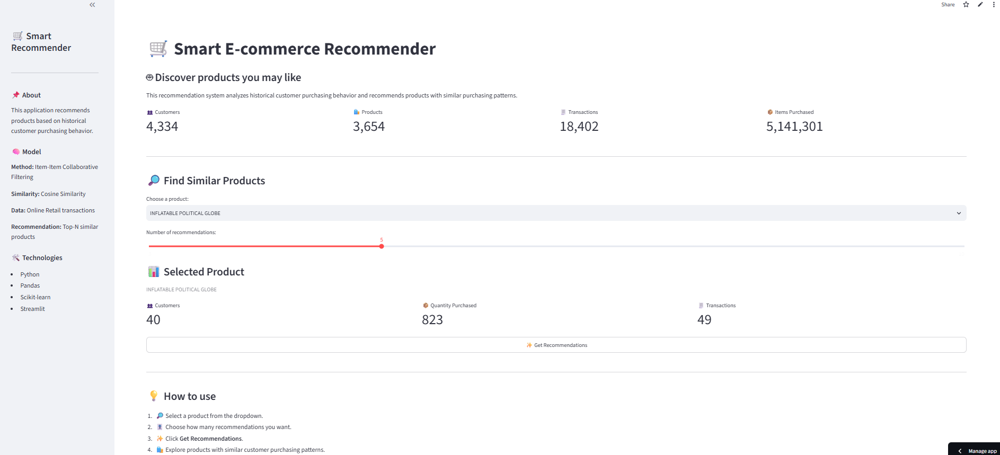
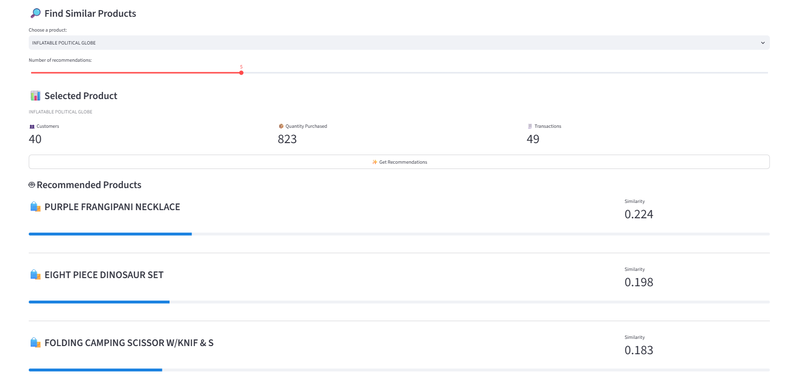

# 🛒 Smart E-commerce Recommender System

A product recommendation system built on real-world e-commerce transaction data, using item-based collaborative filtering to suggest similar products based on customer purchasing behavior.

🔴 **Live Demo:** [smart-ecommerce-recommender.streamlit.app](https://smart-ecommerce-recommender.streamlit.app/)

---

## 📌 Project Overview

This project analyzes historical transaction data from an online retailer and builds a recommendation engine that suggests products based on shared customer purchasing patterns. It was built as a hands-on data science portfolio project, covering the full pipeline from raw data to a deployed, interactive web application.

## 🎯 Problem Statement

E-commerce platforms generate large volumes of transaction data, but without a recommendation system, customers must rely entirely on manual search to discover related products. This project explores whether customer purchase history alone — without product ratings or explicit feedback — can be used to recommend relevant products.

## 🧭 Project Objectives

- Clean and prepare a real, messy transactional dataset for analysis
- Explore the data to extract meaningful business insights
- Build an item-based collaborative filtering recommender using cosine similarity
- Deploy the system as an interactive, publicly accessible web app

## 📊 Dataset

**Source:** Online Retail Dataset (Kaggle)

Raw transaction-level data from a UK-based online retailer, including:

| Column | Description |
|---|---|
| InvoiceNo | Unique transaction identifier |
| StockCode | Unique product identifier |
| Description | Product name |
| Quantity | Units purchased |
| InvoiceDate | Date and time of transaction |
| UnitPrice | Price per unit |
| CustomerID | Unique customer identifier |
| Country | Customer's country |

## 🔄 Project Workflow

```
Raw Data → Data Cleaning → EDA → Recommendation Model → Streamlit App → Deployment
```

## 🧹 Data Cleaning

Performed in `notebooks/data_cleaning.ipynb`:

1. Removed records with missing `CustomerID` (required to identify purchasing behavior)
2. Removed cancelled orders (`InvoiceNo` values starting with "C")
3. Removed invalid transactions (`Quantity <= 0`, `UnitPrice <= 0`)
4. Filtered out non-product / noisy entries using `StockCode` length and keyword matching (e.g. "damaged", "lost", "check"), plus a manually identified known non-product code (`BANK CHARGES`) confirmed by inspecting the unique `StockCode` values that survived initial filtering
5. Converted `InvoiceDate` to datetime
6. Removed duplicate records
7. Engineered a `TotalPrice` feature (`Quantity × UnitPrice`)

The cleaned dataset is exported to `data/cleaned_retail.csv` and used for all downstream analysis and modeling.

## 📈 Exploratory Data Analysis

Performed in `notebooks/eda.ipynb`, focused on answering specific business questions rather than producing graphs for their own sake:

- What are the best-selling products?
- Which customers spend the most?
- Which countries generate the most sales?
- How do sales change over time?

### Key Findings

1. A small number of products — mostly decorative and gift-related items — account for a large share of total sales, suggesting strong customer preference for home decoration products.
2. Customer spending is highly uneven: a small group of customers accounts for a disproportionate share of revenue, making them potential targets for loyalty or retention efforts.
3. Sales are heavily concentrated by country, with the United Kingdom dominating total revenue — suggesting possible international expansion opportunities.
4. Sales volume fluctuates over time, with visible peaks that may reflect seasonal demand and could inform promotional timing.

## 🤖 Recommendation Methodology

Implemented in `notebooks/recommender.ipynb` and the Streamlit app (`app.py`):

1. **Product identity:** Products are identified by `StockCode` rather than `Description`. The same product can appear under multiple slightly different description strings in the raw data, which would otherwise fragment purchase signal across what is really one product. A `StockCode → Description` lookup table is built separately so the app can still display human-readable product names.
2. **Customer–product matrix:** A binary purchase matrix is built (customers × products), where each cell indicates whether a customer purchased a given product at least once — rather than using raw purchase quantity, which would let a small number of bulk/wholesale buyers disproportionately dominate the similarity calculation.
3. **Similarity calculation:** Cosine similarity is computed between product columns, measuring how similarly two products are purchased across the customer base.
4. **Recommendation generation:** For a selected product, the top-N most similar products (by cosine similarity score) are returned and displayed with their similarity scores.

**Important note on interpretation:** the similarity score reflects how similarly two products are purchased across customers — it is **not** a predicted probability that any individual customer will buy the recommended product.

## 🧪 Evaluation

This project currently relies on **qualitative validation** — spot-checking recommendations for several products to confirm they are contextually reasonable (e.g. similar categories or commonly co-purchased items) — rather than a formal quantitative metric.

A proper offline evaluation (e.g. leave-one-out precision@k, where one purchase per customer is hidden and checked against the model's top-N recommendations) was not implemented in this version. This is intentionally documented as a limitation rather than skipped silently — see **Future Improvements** below.

## 🛠️ Technologies Used

- **Python**
- **Pandas** — data cleaning, transformation, aggregation
- **Scikit-learn** — cosine similarity computation
- **Streamlit** — interactive web application
- **Matplotlib** — exploratory data visualizations

## 📁 Project Structure

```
smart-ecommerce-recommender/
│
├── data/
│   ├── online_retail.csv       # Raw dataset
│   └── cleaned_retail.csv      # Cleaned dataset used by notebooks & app
│
├── notebooks/
│   ├── data_cleaning.ipynb     # Data cleaning pipeline
│   ├── eda.ipynb               # Exploratory data analysis
│   └── recommender.ipynb       # Recommendation model development
│
├── app.py                      # Streamlit application
├── requirements.txt            # Project dependencies
└── README.md
```

## ⚙️ Installation & Setup

```bash
# Clone the repository
git clone https://github.com/malakblh/smart-ecommerce-recommender.git
cd smart-ecommerce-recommender

# Install dependencies
pip install -r requirements.txt
```

## ▶️ How to Run

```bash
streamlit run app.py
```

The app will open locally at `http://localhost:8501`.

Alternatively, use the live deployed version — no installation needed:
🔴 [smart-ecommerce-recommender.streamlit.app](https://smart-ecommerce-recommender.streamlit.app/)

## 💡 Example Usage

1. Select a product from the dropdown (shown by name, e.g. "WHITE HANGING HEART T-LIGHT HOLDER").
2. Choose how many recommendations to display (3–10).
3. Click **Get Recommendations**.
4. View similar products along with their similarity scores.

## 📸 Screenshots

### Homepage


### Recommendations


## ⚠️ Limitations

- No formal quantitative evaluation metric is implemented; recommendation quality has only been validated qualitatively (see Evaluation above).
- The dataset is heavily skewed toward UK-based transactions and a small number of high-volume customers, which may limit how well findings generalize to other markets.
- The recommender uses implicit binary purchase signals only — it does not incorporate product ratings, reviews, or explicit customer preferences.
- No cold-start handling exists yet for new products or customers with little to no purchase history.
- Non-product entries in the raw data (e.g. "BANK CHARGES") were identified through manual inspection rather than a fully automated detection process; a small number of similar entries may remain undetected.

## 🚀 Future Improvements

- Implement a formal offline evaluation metric (e.g. leave-one-out precision@k)
- Add a popularity-based fallback for cold-start products with very few purchases
- Explore hybrid recommendation approaches combining collaborative filtering with content-based product features
- Automate detection of non-product entries rather than relying on manual review
- Add more granular customer segmentation to EDA (e.g. RFM analysis)


---

*Built as a data science portfolio project demonstrating the full pipeline from raw data to a deployed, interactive machine learning application.*
